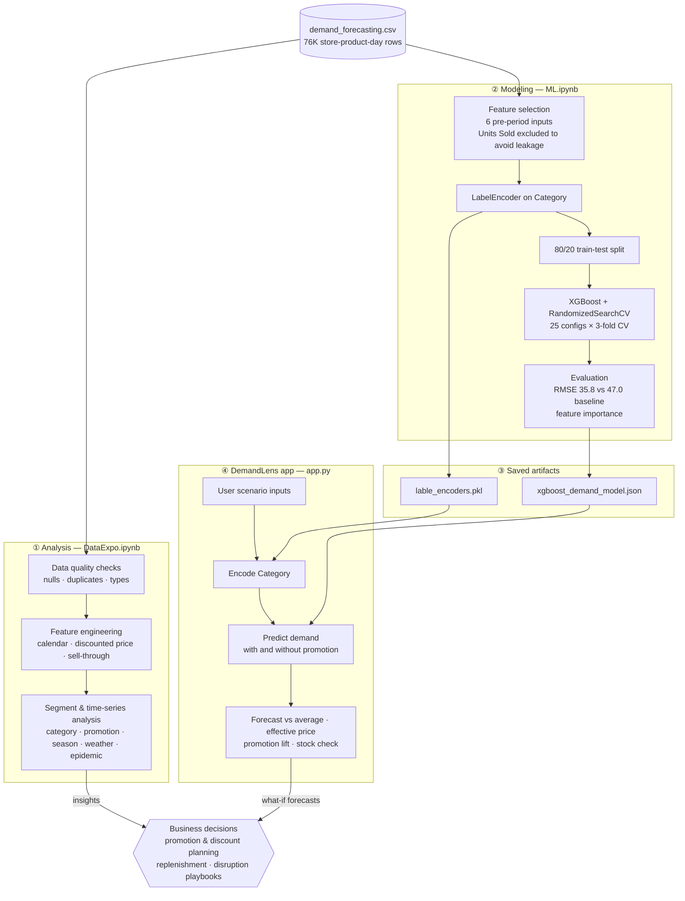

# 📈 DemandLens — Retail Demand Forecasting & Promotion Analytics

> An end-to-end analytics project that quantifies **what drives retail demand** (promotions, discounts, seasonality, weather, disruption events) across 5 stores, 20 products and 5 categories, then puts a tuned **XGBoost** demand model behind a **Streamlit** app so that non-technical teams can run "what-if" scenarios.

   

**DemandLens** turns a lens on demand: it shows *why* demand moves, not just *how much* to expect.

🔗 **Live demo:** [demandlens.streamlit.app]([https://demandlens.streamlit.app](https://mohitarmore-demand-forecasting-model--app-agqcyx.streamlit.app/)) <!-- update once deployed on Streamlit Community Cloud -->

---

## TL;DR — Key Results

| Metric | Value |
|---|---|
| Dataset | **76,000** store-product-day records, Jan 2022 – Jan 2024 (760 days) |
| Scope | 5 stores · 20 products · 5 categories · 4 regions |
| Model | XGBoost regressor, tuned with `RandomizedSearchCV` (25 configs × 3-fold CV = 75 fits) |
| Test RMSE | **35.8 units** vs. **47.0** for a naive "predict the average" baseline → **~24% lower error** |
| #1 demand driver | **Promotion** — 71% of model feature importance, **+30% average demand lift** |
| Biggest risk factor | **Epidemic periods** — demand falls **38%** overall, up to **69%** for Toys |
| Unmet demand | Demand exceeded units sold on **70% of records**, which is **~1.39M units (17.5% of total demand)** lost |

---

## 📸 App Preview

<!-- Save the screenshot as screenshots/app_forecast.png -->


*Set up a scenario (category, inventory, promotion, price, competitor price, discount) and DemandLens returns the predicted demand vs. average, the effective price, the promotion lift and a stock check.*

---

## 🏗️ Architecture: How DemandLens Works



**How it fits together**

1. **Analysis:** the raw data is checked for quality, enriched with calendar, price and inventory KPIs, then sliced by segment and over time. This produces the insights in [section 5](#5-analytical-insights).
2. **Modeling:** six inputs a planner knows *before* the selling period are encoded and used to train a tuned XGBoost regressor, which is then compared against a naive baseline.
3. **Artifacts:** the trained model and the category encoder are saved so that the app uses exactly the same mapping as training.
4. **App:** DemandLens loads the artifacts once, encodes the user's scenario, and predicts demand twice (with and without a promotion) so it can report the lift and check stock coverage.
5. **Decisions:** the EDA insights and the what-if forecasts both feed promotion, pricing, inventory and risk decisions.

---

## 1. Business Problem

Retailers lose money in two ways: by **overstocking** (holding cost, markdowns, waste) and by **understocking** (lost sales, unhappy customers). Both come from not knowing demand ahead of time.

This project answers three questions:

1. **What actually moves demand?** Which commercial levers (price, discount, promotion) and which outside factors (season, weather, epidemics) matter, and by how much?
2. **Can we predict demand** for a product from its commercial setup with useful accuracy?
3. **Can a planner use that prediction** without writing code?

---

## 2. Dataset

`demand_forecasting.csv`: 76,000 rows × 16 columns, with **no nulls and no duplicates** (checked in EDA).

| Group | Columns |
|---|---|
| Keys / time | `Date`, `Store ID`, `Product ID` |
| Product / location | `Category` (Groceries, Clothing, Electronics, Furniture, Toys), `Region` (N/S/E/W) |
| Commercial levers | `Price`, `Discount` (0–25%), `Promotion` (0/1), `Competitor Pricing` |
| Operations | `Inventory Level`, `Units Sold`, `Units Ordered` |
| External factors | `Weather Condition`, `Seasonality`, `Epidemic` (0/1) |
| **Target** | **`Demand`**: mean 104, median 100, std 47, range 4–430 |

---

## 3. Project Structure

```
├── DataExpo.ipynb             # Data exploration: data quality, feature engineering, segment and time-series analysis
├── ML.ipynb                   # Feature selection, encoding, hyperparameter tuning, evaluation, export
├── app.py                     # DemandLens Streamlit "what-if" demand prediction app
├── requirements.txt           # Runtime dependencies for the app (used by Streamlit Community Cloud)
├── screenshots/               # App and chart screenshots used in this README
├── demand_forecasting.csv     # Raw dataset
├── xgboost_demand_model.json  # Trained model (native XGBoost format, portable across versions)
└── lable_encoders.pkl         # Fitted LabelEncoder(s) for categorical inputs
```

---

## 4. Methodology

### 4.1 Data Quality and Preparation
- Checked data types, nulls and duplicates (none found) and converted `Date` to datetime.
- Found **406 zero-inventory (stock-out) records**. These make the sell-through ratio undefined, so they are flagged rather than silently dropped.

### 4.2 Feature Engineering (EDA)
| Feature | Formula | Why it matters |
|---|---|---|
| `Year`, `Month`, `Day`, `Weekday` | from `Date` | Seasonality and calendar effects |
| `Discounted Price` | `Price × (1 − Discount/100)` | The price the customer actually pays |
| `Sell Through Rate` | `Units Sold / Inventory Level` | Inventory efficiency KPI (mean **0.44**, median **0.35**) |

### 4.3 Exploratory Analysis
- **Segment analysis**: demand by Category, Region × Season, Promotion, Weather and Epidemic.
- **Pivot analysis**: Month × Category demand matrix to find category-specific seasonal peaks.
- **Time-series view**: daily total demand trend and average monthly demand profile.
- **Visual diagnostics**: demand distribution, inventory vs. units sold, discounted price vs. demand, and box plots by category and weather.

### 4.4 Modeling
- **Features:** `Price`, `Discount`, `Inventory Level`, `Promotion`, `Competitor Pricing`, `Category`. These are the levers a planner controls or knows *before* the selling period.
- **Leakage control:** `Units Sold` correlates **0.83** with Demand, but it is only known *after* the fact. It was deliberately excluded so that the model can actually be used for forecasting.
- **Encoding:** `LabelEncoder` on `Category`. Ordinal codes are fine for tree models, and no scaling is needed.
- **Split:** 80/20 train/test.
- **Tuning:** `RandomizedSearchCV` over `n_estimators`, `max_depth`, `learning_rate`, `subsample`, `colsample_bytree` and `min_child_weight`, optimizing MAE.
- **Best configuration:** `n_estimators=500, max_depth=8, learning_rate=0.01, subsample=0.8, colsample_bytree=1, min_child_weight=3`. This is a slow-learning, deep ensemble that captures interactions such as Promotion × Category.

### 4.5 Evaluation
| Model | RMSE (units) |
|---|---|
| Naive baseline (predict mean demand) | 47.0 |
| **Tuned XGBoost** | **35.8** |

The tuned model reduces error by about **24%** compared with the baseline, using only six pre-period inputs.

**Feature importance (gain-based):**

| Feature | Importance |
|---|---|
| Promotion | **71.1%** |
| Category | 20.1% |
| Price | 5.0% |
| Competitor Pricing | 1.4% |
| Discount | 1.2% |
| Inventory Level | 1.1% |

### 4.6 Deployment
`app.py` is the **DemandLens** Streamlit app. A user sets up a scenario (category, inventory, promotion on/off, price, competitor price, discount) and gets:
- the **predicted demand**, benchmarked against the average demand in the data;
- the **effective price** after the discount;
- the **promotion lift** for that exact scenario (the model is run with and without a promotion);
- a **stock check** that warns when expected demand exceeds the inventory on hand.

In the app, the model is cached with `@st.cache_resource` and saved in XGBoost's native JSON format, so it doesn't break when library versions change. The app is deployed for free on **Streamlit Community Cloud** straight from this repository.

---

## 5. Analytical Insights

### 5.1 Promotions are the strongest lever
- Average demand is **95 without a promotion** and **123 with one**, a **+30% lift**.
- The lift holds in every category: Clothing +29%, Groceries +29%, Toys +30%, Furniture +30%, Electronics +31%.
- **Implication:** promotion calendars should be planned together with replenishment. A promotion without matching stock turns into a stock-out.

### 5.2 Discounts work as a threshold, not a slope
| Discount | 0% | 5% | 10% | 15% | 20% | 25% |
|---|---|---|---|---|---|---|
| Avg demand | 94.7 | 94.9 | 102.8 | **123.6** | 124.1 | 123.0 |

- A 5% discount produces **no measurable lift**. Demand jumps at **15%** and then **flattens**.
- **Implication:** discounts of 20–25% give away margin for no extra volume. **15% is the efficient point**, and 5% discounts can probably be dropped.

### 5.3 Base price barely matters, and competitor price tracks it
- The correlation between price and demand is about **−0.02**, so demand is largely price-inelastic within the observed range.
- Competitor price correlates **0.98** with own price, so the market prices in lockstep. Being cheaper than the competitor gives **no demand advantage** (104.3 vs. 104.3).
- **Implication:** customers respond to *event-driven* value (promotions, deep discounts), not small differences in shelf price. There is room to protect margin on base price.

### 5.4 Epidemic shocks hit categories very differently
| Category | Normal | Epidemic | Change |
|---|---|---|---|
| Clothing | 112.3 | 113.7 | **+1%** (resilient) |
| Groceries | 130.2 | 83.9 | −36% |
| Electronics | 107.3 | 58.1 | −46% |
| Furniture | 82.6 | 37.5 | −55% |
| Toys | 107.4 | 33.5 | **−69%** |

- Overall demand drops **38%** during epidemic periods.
- **Implication:** disruption playbooks should be specific to each category. Cut Toys and Furniture orders sharply, keep Clothing stock steady, and move working capital toward the categories that hold up.

### 5.5 Seasonality and weather
- **Summer is the peak and Spring is the trough** in every region. The South and East regions have the highest demand and the West the lowest.
- **Sunny days average 115 units vs. 94 on snowy days, a 23% gap.** Weather forecasts can serve as a short-range demand signal.
- **Category peaks:** Groceries in June and August (about 148–150, roughly 23% above the Groceries average). Clothing in December and January (about 127, holiday and winter wear). Toys spike in March (128).
- **Day of week has no effect** (103–105 every day), so staffing and replenishment don't need weekday-specific rules.

### 5.6 Volume concentration
- **Groceries account for 46% of total demand volume** (3.68M of 7.93M units) and have the highest average demand (121). Forecast accuracy matters most here.
- Furniture has the lowest average demand (74) and is a candidate for lean, make-to-order style inventory.

### 5.7 Unmet demand is the hidden opportunity
- On **70% of records, demand was higher than units sold**. The cumulative gap is about **1.39M units, or 17.5% of all demand**.
- The median sell-through rate is only 0.35, so inventory is often **in the wrong place rather than too low**. This points to allocation problems across stores and SKUs, not just total stock levels.

---

## 6. Where This Can Be Applied

| Domain | Use case |
|---|---|
| **Retail and e-commerce** | SKU and store-level replenishment, safety-stock sizing, cutting both stock-outs and overstock |
| **FMCG / CPG** | Promotion planning and trade-spend ROI (with a quantified +30% lift and a 15% discount threshold) |
| **Pricing and revenue management** | Finding margin-wasting discount levels and testing price/promotion scenarios before launch |
| **Supply chain and S&OP** | Feeding demand estimates into procurement, production and distribution planning |
| **Risk and business continuity** | Category-level stress tests for disruption events (pandemic, lockdowns, supply shocks) |
| **Merchandising and category management** | Seasonal assortment and space allocation (Groceries in summer, Clothing in winter) |
| **Finance / FP&A** | Revenue and working-capital forecasting based on the promotion calendar |
| **Quick commerce / dark stores** | Weather-aware short-horizon demand adjustments |

---

## 7. Recommendations for the Business

1. **Make 15% the default promotional discount.** Deeper discounts add no volume and only reduce margin.
2. **Link the promotion calendar to replenishment.** Every promotion needs about 30% extra stock for the SKU.
3. **Keep a disruption playbook for each category.** Cut Toys, Furniture and Electronics quickly during shocks, and protect Clothing and essential Groceries.
4. **Focus forecasting effort on Groceries.** It carries nearly half of all volume, so accuracy gains there have the biggest effect.
5. **Fix allocation before adding inventory.** Low sell-through combined with high unmet demand means stock is in the wrong stores or SKUs.

---

## 8. Limitations and Next Steps

A senior review of the current approach, listing what I would change before production:

| Limitation | Next step |
|---|---|
| **Random train/test split on time-ordered data** can leak future patterns into training | Use time-based validation (train on 2022, test on 2023) with `TimeSeriesSplit` |
| **Strong drivers left out of the model**: Epidemic (−38%), Weather (±23%), Seasonality, Region | Add them as features. EDA suggests they would cut RMSE substantially |
| **No temporal memory** | Add lag and rolling features (demand 7, 14 and 28 days ago, rolling means) and product/store IDs |
| Only RMSE reported | Also report MAE, MAPE/WAPE and bias, the measures planners actually use |
| Unseeded split | Set `random_state` so results are reproducible |
| One global model | Compare per-category models and LightGBM (already imported), and add SHAP for driver explanations |
| Point forecasts only | Quantile regression to produce prediction intervals for safety stock |
| 2024 has only January data | Don't read the lower 2024 average (98 vs. 106 in 2022) as a trend, because it reflects a winter-only sample |

---

## 9. How to Run

**Run the DemandLens app locally**

```bash
pip install -r requirements.txt
streamlit run app.py
```

**Reproduce the analysis**

```bash
pip install -r requirements.txt numpy matplotlib seaborn lightgbm jupyter
```

Open `DataExpo.ipynb` (EDA), then `ML.ipynb` (training). `ML.ipynb` exports `xgboost_demand_model.json` and `lable_encoders.pkl`, which the app loads.

**Deploy your own copy (free)**

1. Fork this repo.
2. Sign in at [share.streamlit.io](https://share.streamlit.io) with GitHub and click **Create app**.
3. Select the repo, branch `main` and main file `app.py`, then choose Python 3.12 under **Advanced settings**.

---

## 10. Tech Stack

**Python** · **pandas / NumPy** (wrangling, aggregation, pivots) · **Matplotlib / Seaborn** (visual EDA) · **scikit-learn** (encoding, split, `RandomizedSearchCV`, metrics) · **XGBoost** (gradient-boosted trees) · **Streamlit** (interactive deployment) · **Jupyter**

---

## 11. Skills Demonstrated

- Turning a business question into an analytical framework and measurable KPIs (lift, sell-through, unmet demand)
- Data-quality auditing and feature engineering
- Segment, cohort and seasonal analysis; quantifying effects rather than just plotting them
- Spotting and preventing target leakage
- Hyperparameter tuning and comparison against a baseline
- Turning model output into **pricing, promotion, inventory and risk recommendations**
- Packaging a model as a self-serve tool for business users

---

### Resume bullets

- *Built an XGBoost demand-forecasting model on 76K retail transactions (5 stores, 20 SKUs) that reduced forecast error by 24% vs. baseline, and deployed it as **DemandLens**, a Streamlit what-if tool that shows predicted demand, promotion lift and stock-out risk for planners.*
- *Quantified a +30% promotional demand lift and found a 15% discount saturation point, showing that 20–25% discounts gave away margin without adding volume.*
- *Measured category-level disruption sensitivity (Toys −69%, Clothing +1% during epidemic periods) and ~17.5% unmet demand, which became recommendations for category-specific risk playbooks and inventory reallocation.*
